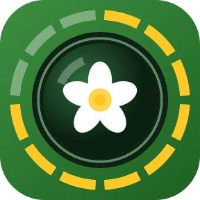

  

<h1 align="center">FaunaLapse</h1>

## Overview

**FaunaLapse turns old or affordable Android phones into time-lapse cameras that watch one spot, for example insects visiting a flower.**

It takes short bursts of photos or short video clips with the screen off, keeps only a square area that you choose on a preview, and closes the camera between bursts. This tries to keep the phone cool and to save battery.

FaunaLapse has no artificial intelligence (AI). Check its sister app,
[FaunaPulse](https://github.com/valentinitnelav/fauna-pulse),
which can detect & track insects in real time with AI on newer phones.

## Status

	
Expand:

On the test phones below, the app installs and test time-lapse sessions ran to the end,
mostly with the screen off (indoors, from minutes to about 1.5 hours).
Field studies & tests outdoors are planned.

Details and measurements per phone: [docs/PHONES.md](docs/PHONES.md).

| Phone | Android | Checked |
|---|---|---|
| Huawei P10 Lite (2017) | 8.0 | photos, video |
| Blackview A60 (2019) | 8.1 (Go edition) | photos, video |
| Xiaomi Redmi Note 9S (2020) | 12 | photos, video, battery use |
| Samsung Galaxy M12 (2021) | 13 | photos, video, battery use |
| Xiaomi 11T Pro (2021) | 14 | photos |
| Emulator (a virtual phone on a computer) | 16 | screens, photos, video |

**Note on LLM usage:**

The code is written with the help of AI coding agents (Claude Code and others),
guided and reviewed by the maintainer.

## Install

FaunaLapse is not yet in the Google Play Store: download the APK (the install file) from the
[releases](https://github.com/valentinitnelav/fauna-lapse/releases) and install it as described in
[docs/INSTALL.md](docs/INSTALL.md) (also updates with Obtainium and uninstalling).

## App features

	
Expand:

- Android 7.0 or newer; old phones are welcome.
- Schedules: recording windows each day (for example 06:00 to 08:00 and 17:00 to 20:00, also across
  midnight or all day under the midnight sun) for several days, or a run of some hours.
- Inside a time window: photo bursts (for example one photo every 2 s for 60 s, then a 5 minute break) or
  video clips (for example 5 minutes of video, then a 5 minute break) at 5, 10 or 15 frames per
  second; fewer frames give smaller files, enough to follow insects from frame to frame on a computer.
  Videos also keep only the square; where the phone allows it, the camera zooms onto the square in
  hardware, so a small square keeps its real detail.
- If a phone cannot take photos as fast as asked, the app suggests video instead.
- Photos and videos keep only a square region of interest that you drag over the subject and pinch to size,
  saved at any multiple of 32 pixels from 224 to 4096 (1280 by default, the input size of many
  insect detectors), never enlarged.
- Focus: fixed at one distance (20 cm to start, set while you watch the camera view), so wind, a
  passing insect or another flower cannot pull the focus away. Phones that cannot fix the focus
  (often the oldest ones) focus automatically at the start of each burst or clip, and the app says so.
- Screen off (a button, or by itself a few minutes after the last touch) and camera closed between
  bursts, to save power and avoid heat.
- A phone check before Start: a phone clock that looks wrong (it often resets when the battery runs
  empty), airplane mode, Wi-Fi, Bluetooth, location, battery limits and Stay awake (a developer
  option that keeps the screen on while charging), each with a button to its settings page, so an
  old phone used only as a camera wastes no energy.
- A pause while the phone is too warm, and a clean stop when the battery runs low or the storage
  is nearly full.
- During a session: the last saved photo on the main screen, and a pause to adjust the phone (with
  the live camera view; nothing is recorded, and the session goes on by itself after 10 minutes).
- Field metadata for each session: who set it up, site, transect, plant, habitat, sample and
  session ID, camera height and distance to the target (named as in the *Camtrap DP* standard for
  camera traps), your own fields (text, notes, number, date, time, yes or no, or a choice from your
  own list), and the phone model and ID (filled in by the app); site photos of the surroundings,
  taken with the phone's camera app and kept apart in the session folder; one GPS position on a tap
  (WGS 84; the GPS switches off again when the position's uncertainty reaches your *Stop at* value,
  10 m unless you change it), or latitude, longitude and uncertainty typed from another GPS device.
- A session log of every photo and event, ready for analysis in R or Python, with the battery use
  of the session.
- Files in `Documents/FaunaLapse` on the phone or on a memory card (SD card), one folder per session
  (phone ID, start time, photo or video): easy to copy to a computer over USB, and kept
  when the app is removed (on a card with Android 7 to 10, Android allows only the app's own folder,
  which goes with the app). The main screen shows how much space FaunaLapse uses and how much is
  free, opens the folder in Android's file app, and during a session shows what it saved so far and
  any phone setting that wastes energy (for example Wi-Fi left on).

## Using it in the field

	
Expand:

1. **At home, once per phone:** install the app ([docs/INSTALL.md](docs/INSTALL.md)), open it and
   allow the camera (on Android 10 or older also the storage). Under *3 · Schedule* tap *Change
   settings* and set the schedule; it stays saved on the phone. Check that the phone time is right.
   With several phones, set them all up this way before you go out. *2 · Field metadata* shows each
   phone's model and ID (write the ID on the phone if you like): the ID starts the session folder
   names, so the files do not mix on the computer. For a phone used only as a camera, follow
   *4 · Phone for the field*: lift the battery limits (Open settings), turn on airplane mode, and open
   its (i) for the full checklist (factory reset, no account, unneeded apps off).
2. **In the field:** fix the phone on a tripod or a clamp, facing the flower. For sessions longer
   than a few hours, connect a power bank.
3. Open FaunaLapse, choose *Photos* or *Video*, tap *Aim the camera*, drag the square onto the
   flower (put your finger inside the square) and pinch it to size. The focus starts fixed at about
   20 cm: tap *Focus again* to focus once on the square and fix it there, or move the focus slider
   until the flower is sharp. Tap *Done*, then *Change field metadata* in *2 · Field metadata*: fill
   in the site, plant and setup, take site photos if you like, and for the position tap *Get
   location* outdoors (Location must be on: *Open settings* beside it switches it on and, afterwards,
   off) or type latitude and longitude from another GPS device, and tap *Done*. Then tap *Start
   session*.
4. Tap *Screen off* on the status card: the screen switches off as with the power button, but
   without pressing the phone where it stands. The first time, Android asks you to allow it
   (FaunaLapse becomes a "device admin app" with the single right to lock the screen; remove it
   under *Last session, battery and clock* before you uninstall FaunaLapse). Or press the power
   button gently. The session goes on; the camera is off in the breaks. If you forget, FaunaLapse
   switches the screen off by itself 3 minutes after the last touch (*Screen off by itself* under
   *3 · Schedule*; it needs the right above). The power button wakes the screen again; a double tap
   works only on phones that offer it and have it turned on.
5. To adjust the phone during a session: tap *Pause to adjust the phone*, then *Aim the camera
   again*; move the phone, the square or the focus, and tap *Continue session*. Nothing is recorded
   during the pause, and the session goes on by itself after 10 minutes. To stop early: tap *Stop
   session*, then *Stop*.
6. **Afterwards:** tap *Pack* on the status card, best on the charger: each photo session becomes
   one zip file, which copies much faster than thousands of photos (FaunaLapse checks every zip
   before it deletes the session folder). Then connect the phone to a computer with a USB cable,
   choose *File transfer* on the phone and copy the zips and video folders from
   `Internal storage/Documents/FaunaLapse/` (or the same folder on the SD card, if you chose it on the
   status card). Extract each zip to get its session folder back. Each folder holds the photos (or
   videos) and `session.jsonl`, the record of every photo and event with the field metadata and the
   battery use.

Tips: a daily window may cross midnight (22:00-04:00), and 00:00-24:00 records all day, for example
under the midnight sun. Memory cards differ in speed: before photos every 1 or 2 s on a card, run a
short test session; if FaunaLapse then says that photo times were skipped, use video or the phone
storage. The session pauses while the battery is too warm (45 °C by default) and stops
cleanly when the battery falls to 15 % without charging. Some phones stop apps in the background to
save power with their own battery manager (Huawei, Xiaomi, Samsung): the checklist under the (i) of
*4 · Phone for the field* says where to allow FaunaLapse.

## Documentation

	
Expand:

- [docs/INSTALL.md](docs/INSTALL.md): install, update and uninstall; release builds.
- [docs/PHONES.md](docs/PHONES.md): test phones and measured results.
- [docs/PRIVACY.md](docs/PRIVACY.md): privacy policy (the app collects and sends nothing).
- [AGENTS.md](AGENTS.md): rules and commands for contributors, human or AI coding agents.
- [docs/AGENT_OVERVIEW.md](docs/AGENT_OVERVIEW.md): current state, file map and next steps (written
  for coding agents, readable for humans).

## Citation

If you use FaunaLapse in your research, please cite it with the metadata in
[CITATION.cff](CITATION.cff) (GitHub shows a "Cite this repository" button from it). Every release
is archived on Zenodo with a DOI.

Example:

> Ștefan, V. & Knight, T. (2026). FaunaLapse: a smartphone application for scheduled time-lapse monitoring of insects and other animals. https://doi.org/...

## Licence

FaunaLapse is free and open-source software under the GNU Affero General Public License, version 3
only (AGPL-3.0-only): anyone may use, study, change and share it, but whoever shares a changed
version must share its source code under the same licence. See [LICENSE](LICENSE).

For use under other terms (for example in a closed product), contact the author.
